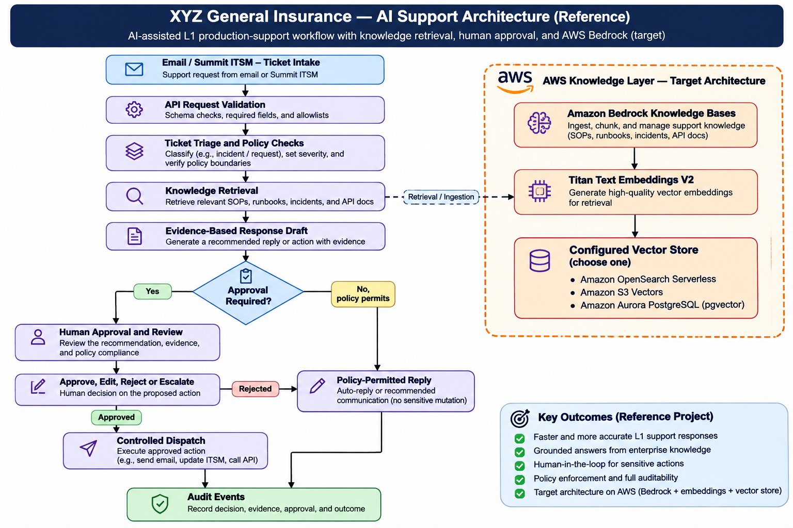

# XYZ General Insurance — AI-Driven Production Support (Sanitized Reference Project)

A GitHub-ready reference implementation for an AI-assisted L1 production-support workflow. All names, incidents, ticket IDs, API responses, and documents in this repository are fictional.

## What this repository demonstrates

- Document-aware chunking for SOPs/runbooks, incident-aware chunking for tickets, and operation-aware chunking for API documentation.
- A local retrieval baseline using synthetic knowledge documents.
- A support-ticket API with triage, retrieval, response drafting, and a human-approval gate for actions.
- Explicit policy boundaries: the model may recommend; it does not authorize sensitive actions.
- Sanitization, secret-management, audit, and test guidance.
- An AWS target architecture using Amazon Bedrock Knowledge Bases, Titan Text Embeddings V2, and a separately configured vector store (OpenSearch Serverless, S3 Vectors, or Aurora PostgreSQL/pgvector).

> **Implementation status:** This is a local runnable reference scaffold. The local retriever uses lexical scoring, not embeddings. AWS services and live Summit ITSM/BaNCS/email integrations are represented as documented integration seams and are not connected by default. Do not describe this repository as a production deployment.

## Architecture

The diagram below illustrates the AI-assisted production-support workflow, human approval controls, audit trail, and target AWS knowledge architecture.




## Quick start

Requires Python 3.11+.

```bash
python -m venv .venv
# Windows PowerShell:
.venv\Scripts\Activate.ps1
# macOS/Linux:
source .venv/bin/activate

python -m pip install -r requirements.txt
uvicorn app.main:app --reload
```

Open `http://127.0.0.1:8000/docs` for the API docs.

Run tests:

```bash
pytest -q
```

## Example request

```bash
curl -X POST http://127.0.0.1:8000/tickets/analyze \
  -H "Content-Type: application/json" \
  -d '{
    "ticket_id": "DEMO-1001",
    "subject": "Payment status inquiry",
    "description": "How do I check whether a payment request completed?",
    "application": "PolicyAdmin",
    "error_code": null
  }'
```

The response includes a category, retrieved synthetic evidence, a draft, and an approval requirement. This demo does not send emails or call business APIs.

## Chunking strategy

See [`docs/chunking-strategy.md`](docs/chunking-strategy.md). Starting hypotheses to evaluate:
- SOPs/runbooks: preserve headings and procedure boundaries; consider hierarchical parent/child chunks where the selected Bedrock Knowledge Bases configuration supports it.
- Incident tickets: one incident per logical unit; split long histories by troubleshooting stage, never across unrelated incidents.
- API documentation: one operation/error definition per logical unit; keep request/response schema, error meaning, remediation, and authorization constraints together.
- Initial test values only: roughly 500 tokens for general chunks, 250–400 tokens for smaller procedural child chunks, and modest overlap where supported. Validate against a 50–100-question sanitized evaluation set before production.

Token counts depend on the tokenizer. The local demo uses a simple word-based approximation for demonstration only.

## Security and sanitization

Read [`SECURITY.md`](SECURITY.md) and [`docs/sanitization-policy.md`](docs/sanitization-policy.md) before publishing.
- Only fictional data is included.
- Do not commit customer data, real ticket exports, production identifiers, secrets, access tokens, or confidential architecture documents.
- Keep `.env` files out of Git; use `.env.example` with placeholders.
- Human approval is required by default for external actions and any data mutation.
- Confidence scores must never be treated as authorization.

## Repository layout

```text
app/
  main.py                 FastAPI endpoints
  models.py               Request/response models
  chunking.py             Document-aware chunking examples
  retrieval.py            Local synthetic lexical retriever
  policy.py               Approval policy gate
  audit.py                Local structured audit event helper
  data/knowledge/         Fictional documents
tests/                    Unit and API tests
docs/                     Architecture, chunking, sanitization, evaluation
scripts/                  Sanitization scanner
```

## AWS implementation path

1. Replace the local retriever with Amazon Bedrock Knowledge Bases retrieval.
2. Configure Titan Text Embeddings V2 through the Knowledge Base ingestion pipeline.
3. Choose one vector store based on workload and cost testing: OpenSearch Serverless, S3 Vectors, or Aurora PostgreSQL with pgvector. Do not provision all three by default.
4. Add IAM least-privilege roles, Secrets Manager, KMS, CloudWatch, CloudTrail, and X-Ray as appropriate.
5. Integrate Summit ITSM, email, and permitted business APIs through explicit adapters and allowlists.
6. Add durable queues/retries/DLQs and idempotency for asynchronous integrations.
7. Run security, load, retrieval-quality, and human-approval acceptance tests before production.

## Disclaimer

This repository is an educational/reference scaffold and is not affiliated with or endorsed by any insurer or AWS. Service names are used to describe possible integration points. No customer or production data is included.
